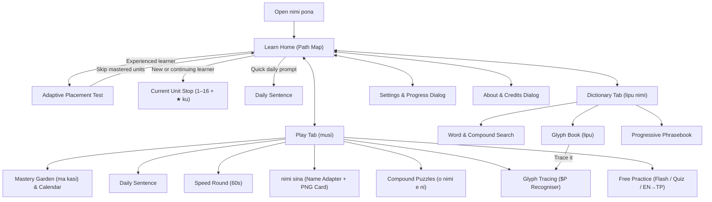
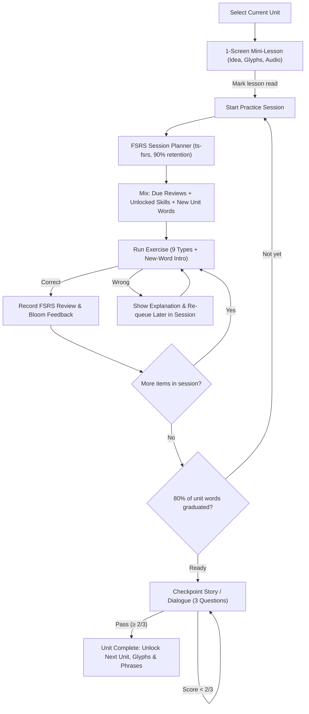
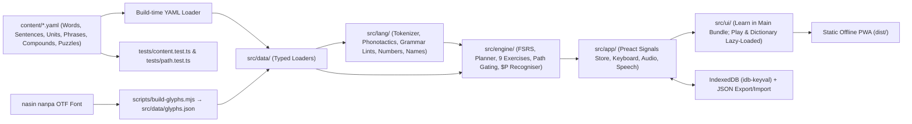

# nimi pona

**A calm, offline-first Toki Pona course-game for learning vocabulary, grammar, and *sitelen pona*.**

> ### 👉 [Launch the Live App](https://archive.mikehiggins.me.uk/notes/app-bundle-01/nimi-pona/)
>
> Made by **[Mike Higgins](https://mikehiggins.me.uk/)**

---

## Overview

**nimi pona** takes a learner from zero to reading simple Toki Pona sentences and *sitelen pona* hieroglyphs. Instead of rote flashcard memorisation, it treats Toki Pona words as semantic spaces, teaches particle grammar step by step, and builds retention through spaced repetition (FSRS) and gentle mini-games.

### Guiding principles
- **Teach how Toki Pona actually works:** Words are semantic spaces, grammar is a small set of particles (`li`, `e`, `pi`, `la`, `o`, `en`, `anu`), and meaning comes from composition.
- ***sitelen pona* as first-class script:** All 138 glyphs are embedded as SVG path outlines (extracted at build time from *nasin nanpa*), animated with ink-stroke reveals, and used across cards, sentences, name cartouches, and glyph tracing.
- **Calm motivation (*pona*):** No punishing streak counters or leaderboards—just a steady path, a mastery garden (`ma kasi`) where nothing wilts, and a four-week practice calendar that treats rest days as part of learning.
- **Machine-verified content:** Every word, example sentence, unit lesson, and checkpoint story is checked by a Toki Pona phonotactics and grammar linter before shipping.
- **Offline-first & accessible:** Installs as a static PWA with no backend, stores progress locally in IndexedDB (with JSON export/import), supports full keyboard navigation, and passes WCAG 2.2 AA accessibility checks.

---

## User Flows

### 1. High-level App Navigation & Learner Journey



### 2. Unit Progression & Spaced-Repetition Loop



### 3. Content-to-UI Architecture



---

## Features in Detail

### Learn (`kama sona`)
- **16-unit guided path + ★ Beyond *pu*:** Covers all 120 *pu* words, the 3 *pu* synonyms (`kin`, `namako`, `oko`; `ali` as a variant of `ale`), and an optional 15-word *ku suli* tier. Units progress from `mi`/`sina` predicates through `li`, `e`, modifiers, `ala`/`anu`, `seme`, prepositions, preverbs, `o`, `pi`, `la`, *pu* numbers, name cartouches, feelings/body, *sitelen pona*-only reading, and short graded stories.
- **Adaptive placement test:** Experienced speakers can test out of earlier units; skipped words move straight into spaced repetition review.
- **FSRS spaced repetition:** Powered by `ts-fsrs` (90% target retention). Each word tracks up to 4 skills—*meaning*, *recall*, *sitelen pona*, and *listening*—unlocking follow-on skills once recognition is learned.
- **9 exercise types (all keyboard-operable):**
  1. Multiple choice (both directions, semantically filtered distractors)
  2. Typed recall (Levenshtein ≤ 1 typo tolerance for words over 4 letters)
  3. Glyph → word and word → glyph
  4. Listening (Web Speech Spanish/Italian voice respelled for Toki Pona phonetics)
  5. Particle fill-in (`li`, `e`, `pi`, `la`, `o`, etc.—never offers two ambiguous particles)
  6. Sentence builder (tap/keyboard word tiles)
  7. Spot the mistake (grammar errors generated from the corpus and verified by the linter)
  8. TP → EN translation (keyword grading with an "I was right" override)
  9. Self-graded flashcards (`Again` / `Hard` / `Good` / `Easy`)
- **Unit checkpoints:** Each unit ends with a short dialogue or story and comprehension questions (Unit 15 is *sitelen pona* only).

### Play (`musi`)
- **Mastery garden (`ma kasi`):** Grows one `kasi` plant per learned word; height tracks FSRS stability, words held for a month flower, and nothing wilts.
- **Daily sentence (`toki pi tenpo suno`):** One sentence per day chosen from words you've already met, paired with a gentle 4-week practice calendar.
- **Speed round (`tenpo lili`):** 60-second rapid recognition with keyboard `1`–`4`, personal best tracking, and a review list of missed words.
- **Name adapter (`nimi sina`):** Adapts any name into Toki Pona phonotactics (as a person, place, or language), renders its *sitelen pona* cartouche with a letter key, speaks it aloud, and exports a shareable PNG card.
- **Compound puzzles (`o nimi e ni`):** 35 creative compound-building puzzles accepting multiple valid Toki Pona descriptions, with hints and a "Mine works too" option.
- **Glyph tracing:** Draw *sitelen pona* glyphs (trace or from-memory mode) scored against font outlines using a pure-TypeScript `$P` point-cloud recogniser.
- **Free practice:** Classic Flash, Quiz, and EN→TP modes with topic filters (17 semantic themes).

### Dictionary (`lipu nimi`)
- **Smart search:** Search by Toki Pona word, spelling variant, English gloss, or compound (e.g. searching `"car"` surfaces `tomo tawa`).
- **Rich entries:** Concept line, grammar roles, usage notes, translated examples with *sitelen pona* and audio, related compounds, and per-skill mastery bars.
- **Glyph book (`lipu`):** Collect all 120 (+ *ku*) glyphs as you meet them, view animated stroke-in cards with example sentences, or jump straight into tracing.
- **Phrasebook:** Practical expressions (`toki!`, `moku pona`, `lape pona`, etc.) that unlock as you progress along the path.

### Design, Accessibility & Privacy
- **Ink-and-paper aesthetic:** Warm paper light mode and deep ink-blue dark mode (*tenpo pimeja*), Fraunces for Toki Pona display text, Atkinson Hyperlegible for UI, and optional synthesised wooden/chime audio feedback.
- **Writing system toggle:** Switch between Glyph + Latin, Glyphs only, or Latin only at any time.
- **Sensitive content policy:** `unpa` remains in the dictionary but is excluded from games by default (configurable in Settings).
- **100% client-side:** No accounts, tracking, or backend. Progress lives in IndexedDB and can be exported/imported as JSON or reset in Settings.

---

## Tech Stack & Quality

- **Runtime:** [Preact](https://preactjs.com/) + `@preact/signals`, TypeScript, plain CSS custom-property tokens
- **Spaced repetition & storage:** `ts-fsrs`, `idb-keyval`
- **Build & PWA:** Vite 6, `vite-plugin-pwa` (Workbox)
- **Bundle budget:** **97 KB gzipped** initial JS (budget: 150 KB); `PlayView` (8.2 KB gz) and `Dictionary` (2.5 KB gz) are lazy-loaded
- **Lighthouse (production build):** Desktop **100 / 100 / 100 / 100**, Mobile **98 / 100 / 100 / 100** (Performance / Accessibility / Best Practices / SEO)
- **Automated testing:**
  - **119 Vitest unit & content tests** covering phonotactics, grammar lints, vocabulary ordering, FSRS 7-day learner simulation, path gating, and `$P` glyph recognition
  - **118 Playwright E2E, axe WCAG 2.2 AA accessibility (17 screens × light/dark), and visual regression tests (24 snapshots)** across desktop and mobile

---

## Getting Started

```bash
npm install
npm run dev            # start local dev server
npm run build          # notices → typecheck → production PWA build → JS budget check
npm run preview        # serve the production build locally
```

### Testing

```bash
npm run check          # TypeScript typecheck + Vitest unit/content suite
npm run lint:content   # content gate only: phonotactics, grammar lints, vocabulary order, coverage
npm run test:e2e       # Playwright E2E, axe accessibility, and visual regression (against prod build)
npm run test:all       # run everything
```

- Playwright requires Chromium (`npx playwright install chromium` if not already installed).
- Visual baselines in `e2e/visual.spec.ts-snapshots/` are macOS (`-darwin`); on another OS, regenerate them with `npx playwright test e2e/visual.spec.ts --update-snapshots`.

### Maintenance Scripts

```bash
npm run build:glyphs   # re-extract sitelen pona SVG outlines from nasin nanpa → src/data/glyphs.json
npm run build:icons    # render SVG + PNG PWA icons from the pona glyph
npm run build:notices  # regenerate public/THIRD_PARTY_NOTICES.txt from shipped dependencies
npm run size           # check initial-load JS against the 150 KB gzipped budget
```

---

## Project Layout

```text
├── content/             # Human-authored YAML source of truth (words, sentences, units, phrases, compounds, puzzles)
├── docs/                # Toki Pona language reference, style guide, and legacy audit
├── src/
│   ├── lang/            # Pure Toki Pona toolkit (tokenizer, phonotactics, grammar lints, numbers, name adapter)
│   ├── data/            # Typed content loaders and extracted sitelen pona SVG path data (glyphs.json)
│   ├── engine/          # Pure logic: FSRS scheduler, session planner, 9 exercise generators/graders, path gating, $P recogniser
│   ├── app/             # Signals store, IndexedDB persistence, keyboard shortcuts, audio, Web Speech
│   └── ui/              # Preact views (learn/, play/, dict/, components/) and ink-and-paper CSS tokens
├── tests/               # Vitest unit, content-lint, path-gate, and simulated-learner tests
├── e2e/                 # Playwright E2E, axe accessibility, and visual snapshot tests
├── scripts/             # Glyph extraction, icon generation, licence notices, and bundle-size gate
├── assets/fonts/        # nasin nanpa font (build-time only; not shipped in dist/)
├── public/              # PWA icons, robots.txt, THIRD_PARTY_NOTICES.txt
├── legacy/index.html    # Original single-file prototype, kept for reference
└── PLAN.md              # Phased roadmap and design notes
```

---

## Credits & Attribution

- **Created by:** [Mike Higgins](https://mikehiggins.me.uk/) · [Live App](https://archive.mikehiggins.me.uk/notes/app-bundle-01/nimi-pona/)
- **Toki Pona:** Created by Sonja Lang (*Toki Pona: The Language of Good*, 2014).
- ***sitelen pona* glyphs:** [nasin nanpa](https://github.com/ETBCOR/nasin-nanpa) by jan Itan, MIT licence (`assets/fonts/nasin-nanpa-LICENSE.txt`).
- **Fonts:** Fraunces and Atkinson Hyperlegible via Fontsource (SIL OFL).
- **Third-party notices:** See [`public/THIRD_PARTY_NOTICES.txt`](public/THIRD_PARTY_NOTICES.txt) (also accessible via **About & credits** in the app).
